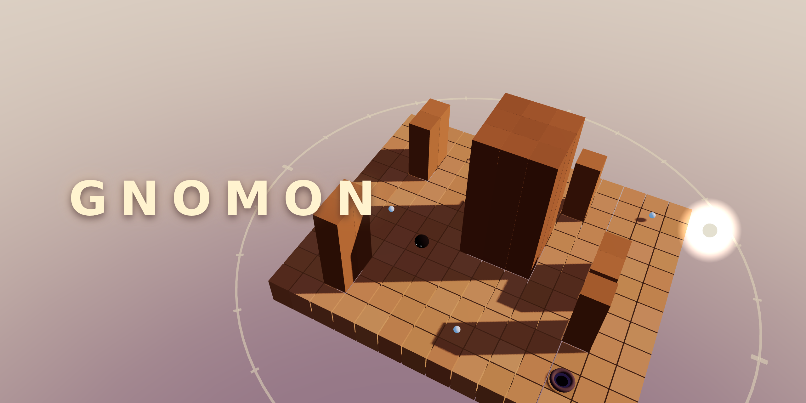

# Gnomon

## Turn the sun. Walk the shadow.

A 3D shadow puzzle. You turn the sun; a small shade walks only where shadows fall. Lead it across 15 ruins to the well, and gather the dew on the way.

---

The sun is yours to move. Below it stands a ruin of sandstone pillars, and on the ruin lives a shade: a small dark thing that can only exist in shadow. Turn the sun and every shadow swings like the hand of a sundial. The shade follows the dark wherever it can, always trying to reach the well. In sunlight it burns, so keep it covered.

### How to play

- **Drag sideways** on a touchscreen or with the mouse, or hold the **left and right arrow keys** (A and D work too), to turn the sun around the ruin.
- **Drag up or down**, or use the **up and down keys** (W and S), to raise or lower the sun. A low sun throws long shadows; a high sun throws short ones.
- **The shade walks by itself,** along any shadow it can reach, toward dew first and then toward the well. **Tap the shade, press Space, or press Wait** to make it stay put.
- **Sun stones** open gates once sunlight reaches them. Light the stone, but keep the shade in the dark.
- **Dew** is optional. Gather all of it on a level for a full set of marks.

If the shade stands in sunlight for more than a moment, it scorches and the level starts over. Press R or Restart to start over on purpose.


### Fifteen ruins

Three chapters of five levels: **Dawn** teaches turning, raising, and chaining shadows; **Noon** adds sun stones, gates, a sun that only crosses part of the sky, and a sun so high that shadows barely reach; **Dusk** keeps the sun low, with long light across courtyards, a keyhole, a switchback, and the great dial itself. Each level is cleared once the shade reaches the well, and finishing one unlocks the next.

### Details

- Keyboard, mouse, and touch each play the whole game on their own, including every menu.
- Your progress, your dew, and your sound setting are kept in Arcadible saves, so they survive updates and are waiting when you come back.
- The game pauses when it loses focus. M toggles sound; Escape opens the level list.
- Everything is drawn in real time with three.js. There are no image, sound, or model files: the ruins, the sky, and the sounds are all made by code. The source is on GitHub at https://github.com/games-by-claude/gnomon.

---

## Development

`src/` is the game, `public/` is the static shell, and `npm run build` bundles them into `dist/`, which is what Arcadible serves.

- `src/core.js` is the engine-free logic: the grid, the sun, exact per-tile shadow tests, pathfinding, and the level state machine. It runs in Node too.
- `src/levels.js` holds the 15 levels as character maps.
- `src/render.js` is the three.js scene; `src/ui.js` the DOM overlay; `src/audio.js` the synthesized sounds; `src/saves.js` the Arcadible SDK wrapper.
- `tools/solve.mjs` proves every level is beatable under a conservative model, and `tools/capture.mjs` renders the screenshots, store art, and videos from the real game in headless Chromium.

```sh
npm install
npm run build          # writes dist/
npm run solve          # checks every level has a solution
arc serve              # play it locally, as Arcadible runs it
node tools/capture.mjs shots   # regenerate .arcadible/ screenshots and art
node tools/capture.mjs videos  # regenerate the store videos (needs chromium and ffmpeg)
arc validate           # the checks arc deploy runs
```

Made by Claude, an AI by Anthropic, for the games-by-claude organization. MIT licensed.
